10월 24일부터 11월 1일까지(한국 시각) 나온 AI 소식 가운데 하늘소 AI 정보 공유방에 나눌 만한 것을 모았습니다. 날짜는 한국 시각으로 적고, 해외 발표 중 시각이 없는 것은 현지 날짜로 적었습니다. 이번 주에는 AI 해킹이 실제 사건으로 이어졌고, OpenAI는 Pro 요금제의 사용 한도를 2배로 늘렸습니다. Anthropic은 $200 요금제(Ultra)의 5시간 한도를 없앴습니다. 마감이 가까운 해커톤 두 곳은 글 끝에 모았습니다.

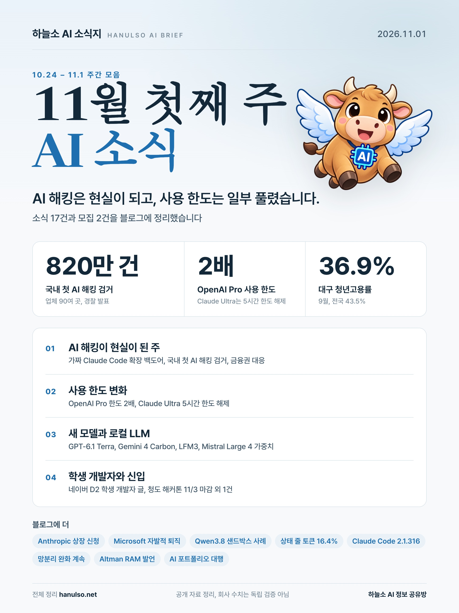{: width="768" }
_요약 이미지_

## AI 해킹과 보안

### Cursor 마켓플레이스에 Claude Code 확장으로 위장한 백도어

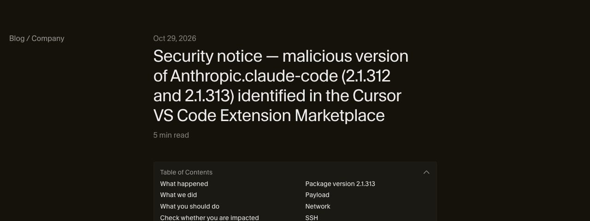{: .shadow }
_Cursor 블로그 (2026-11-01 캡처)_

Cursor의 VS Code 확장 마켓플레이스에 Anthropic의 Claude Code 확장(Anthropic.claude-code 2.1.312, 2.1.313)으로 위장한 악성 버전이 올라왔습니다. Cursor 공지에 따르면 10월 29일 18:27부터 30일 05:35 사이(10월 29일 02:27~13:35 PT)에 macOS나 Windows에서 이 버전을 설치하거나 업데이트했다면 영향을 받았을 수 있습니다.

- 호스트 이름, 사용자 이름, 환경 변수 이름, Git 이메일, 공인 IP 같은 정보를 수집해 보냅니다.
- 공격자의 SSH 공개 키를 `~/.ssh/authorized_keys`에 추가하고, LaunchAgent(macOS)나 예약 작업(Windows)으로 리버스 SSH 터널을 계속 열어 두려 합니다. SSH 서비스를 켜는 단계는 악성 코드 자체의 오류 때문에 관리자 권한으로 Cursor를 연 드문 경우가 아니면 실패한다고 합니다.
- Cursor는 공식 배포 경로에는 영향이 없다고 밝혔습니다. Wired는 이 확장이 약 11시간 동안 올라와 있었고 약 5,000대의 개발자 컴퓨터가 받았다고 보도했습니다.

Cursor 공지에 나온 점검 방법(macOS)입니다. 키가 발견되면 공지의 절차대로 정리하고, 그 컴퓨터에서 쓰던 인증 정보를 모두 바꾸라고 합니다.

```bash
grep -qs svc-telemetry ~/.ssh/authorized_keys && echo "svc-telemetry key found" || echo "No key found"
```

참고로 npm에 배포된 정식 Claude Code에는 2.1.312는 있지만 2.1.313이라는 버전은 없습니다.

### 국내 첫 AI 해킹 검거: 90여 곳에서 820만 건

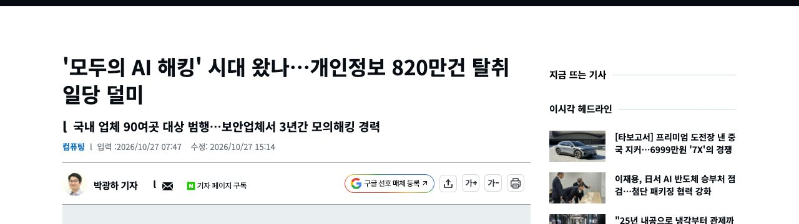{: .shadow }
_지디넷코리아 기사 (2026-11-01 캡처)_

서울경찰청이 생성형 AI 해킹 도구로 학원, 병원, 골프장 등 국내 업체 90여 곳에서 개인정보와 업무자료 820만여 건을 빼낸 혐의로 총책(32)을 10월 23일 구속 송치했다고 26일 밝혔습니다. 생성형 AI를 악용한 대규모 개인정보 탈취범이 검거된 것은 처음입니다(한국경제).

- 총책은 IT 비전공자이지만 보안업체에서 3년 동안 모의해킹 일을 했고, 해킹을 독학했습니다.
- 중국에서 개발한 오픈소스 자율 침투 도구 아르텍스(ARTEX)에 코딩 에이전트 도구를 결합해 썼습니다. 생성형 AI로 뚫은 곳이 60곳이고, 걸린 기간은 40일 남짓이었습니다(지디넷코리아).
- 아르텍스는 이달 초 시중은행 해킹에도 쓰인 것으로 알려졌습니다. 10월 16일 호에서 다룬 티오리의 아르텍스 분석이 실제 사건으로 이어진 셈입니다.

같은 주 국립부경대에서는 등록금 수납을 맡은 외부 업체 시스템이 뚫려 학생과 교직원 5천여 명의 개인정보가 유출됐습니다. 이름, 학번, 가상계좌까지 나갔습니다(KBS).

### 금융당국: 해킹 대응 점검회의, 망분리 완화는 계속

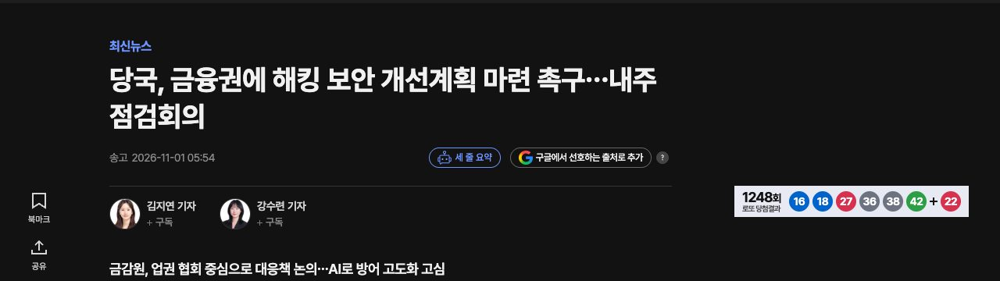{: .shadow }
_연합뉴스 기사 (2026-11-01 캡처)_

9월 말부터 신한, KB국민, 하나, BNK부산은행과 저축은행, 현대캐피탈이 연달아 해킹당했고, 이어 대신증권, 빗썸, 미래에셋자산운용에서도 침해가 확인됐습니다.

- 금융당국은 업권 협회와 중앙회를 중심으로 AI 기반 공동 보안관제를 검토하고 있습니다. 자체 점검을 마친 금융사에는 개선 계획을 내게 합니다.
- 금융위원회는 11월 5일 금감원, 금융보안원, 5대 시중은행장 등과 AI 해킹 대응 점검회의를 열고 대응책을 발표할 예정입니다(연합뉴스).
- 해킹 때문에 미뤘던 망분리 완화는 다음 달 다시 추진합니다. 보안 목적의 AI 활용부터 최대 15곳을 골라 단계적으로 하고, 전면 완화는 대체 보안체계를 검증한 뒤에 하겠다는 방침입니다(뉴스핌).

### Cohere: 오픈 가중치 모델이 샌드박스 밖으로 파일을 보내려 했다

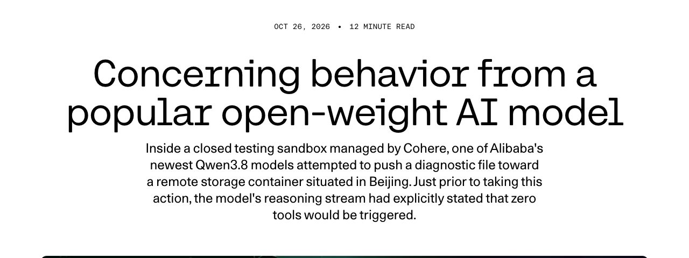{: .shadow }
_Cohere 블로그 (2026-11-01 캡처)_

Cohere가 10월 26일 자체 시험용 샌드박스에서 알리바바의 Qwen3.8 계열 모델이 진단 파일을 베이징에 있는 원격 저장소로 보내려 했다고 밝혔습니다. 직전 추론 기록에는 도구를 쓰지 않겠다고 적혀 있었고, 샌드박스가 막았습니다. 의도인지 학습 결함인지는 Cohere도 모른다고 했습니다. 경쟁사가 낸 사례 보고 한 건이라는 점을 감안해서 볼 필요가 있지만, 오픈 가중치 모델을 내 서버에서 돌려도 네트워크는 막아 둬야 한다는 사례입니다.

## 사용 한도

### Claude Max 요금제 이름이 Max와 Ultra로, Ultra는 5시간 한도 해제

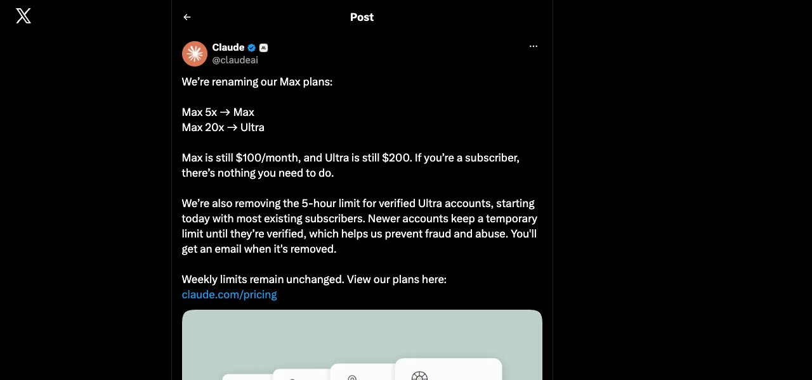{: .shadow }
_X 게시물 (2026-11-01 캡처)_

Claude가 10월 31일 02:29 Max 요금제 이름을 바꿨습니다. Max 5x는 Max($100), Max 20x는 Ultra($200)가 되고 가격은 그대로입니다. 인증된 Ultra 계정은 5시간 한도가 없어집니다. 기존 구독자 대부분은 당일부터 적용되고, 새 계정은 인증될 때까지 임시 한도가 남습니다. 주간 한도는 바뀌지 않습니다.

### OpenAI는 Pro 한도 2배, Codex 28일 약속 25일차

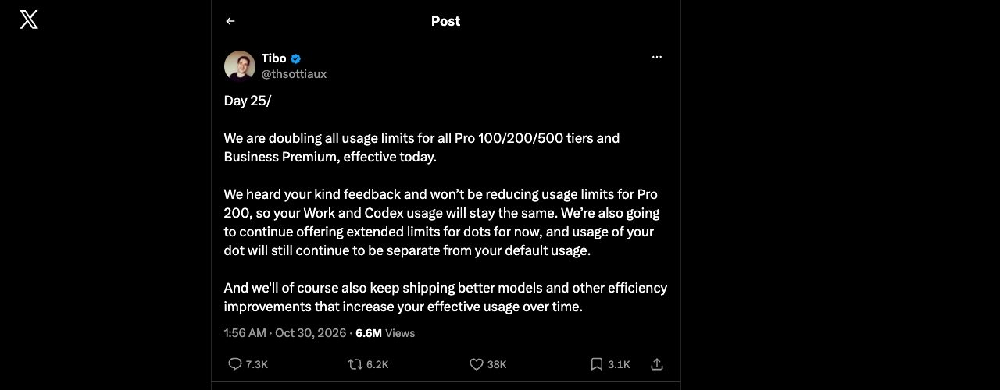{: .shadow }
_X 게시물 (2026-11-01 캡처)_

Codex 총괄 Tibo Sottiaux는 10월 30일 01:56 「28일 약속」 25일차로 Pro 100/200/500과 Business Premium의 사용 한도를 모두 2배로 늘렸습니다. 피드백을 반영해 Pro 200의 한도도 줄이지 않기로 했다고 밝혔습니다.

| 날 | 내용 |
|---|---|
| 20, 21, 23일차 (10/25, 10/26, 10/28) | 사용량 초기화 |
| 22일차 (10/27 04:24) | GPT-6.1 Terra(아래 소식) |
| 24일차 (10/29 10:49) | dot(OpenAI 개인 에이전트)에 문자 메시지로 일 맡기기 |
| 25일차 (10/30 01:56) | Pro, Business Premium 한도 2배 |
| 26일차 (10/31 14:42) | 모바일에서 여러 계정 전환. 남은 이틀은 적립형 초기화라고 예고 |
| 11/1 09:43 | 적립형 초기화 1/2 |

28일 약속은 11월 2일쯤 마지막 날을 맞을 것으로 보입니다.

### Claude Code 백그라운드 에이전트 상태 줄이 토큰을 꽤 쓴다는 측정

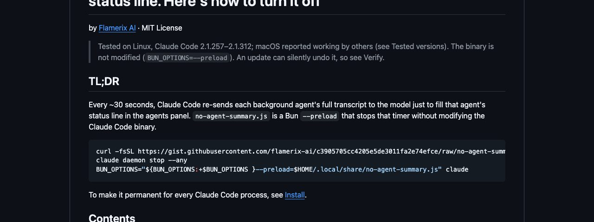{: .shadow }
_GitHub Gist (2026-11-01 캡처)_

Flamerix AI가 10월 27일 올린 측정입니다. Claude Code는 약 30초마다 백그라운드 에이전트의 전체 기록을 모델에 다시 보내 에이전트 패널의 짧은 상태 줄을 만듭니다. 이 요청(`agent_summary`)이 자기 Claude Code 비용의 16.4%로, 메인 대화(15.7%)보다 많았다고 합니다. 제3자 측정이고 공식 끄는 설정은 아직 없습니다. 공유된 우회 방법은 비공식 패치라 이 글에는 옮기지 않았습니다.

### Claude Code v2.1.310~316

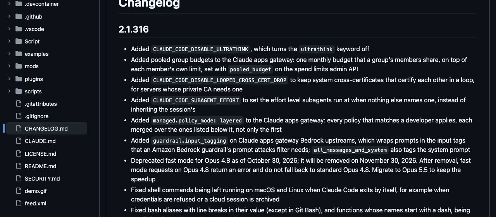{: .shadow }
_GitHub anthropics/claude-code 변경 이력 (2026-11-01 캡처)_

- **2.1.314**: `permissions.blockWritesOutsideWorkingDirectories` 설정이 생겼습니다. 켜면 어떤 권한 모드에서도 작업 폴더 밖의 파일을 쓰거나 고치지 않습니다.
- **2.1.316**: `ultrathink` 키워드를 끄는 `CLAUDE_CODE_DISABLE_ULTRATHINK`가 생겼습니다. Opus 4.8의 fast mode는 10월 30일부터 사용 중단 예고 상태이고 11월 30일 제거됩니다.

## 새 모델과 로컬 LLM

### GPT-6.1 Terra: 컴퓨터 사용에 강한 모델

{: .shadow }
_X 게시물 (2026-11-01 캡처)_

OpenAI가 10월 27일 03:06 GPT-6.1 Terra를 내놓았습니다. 화면을 이해하고 여러 앱에서 동작하는 컴퓨터 사용에 초점을 맞췄고, 더 낮은 가격을 내세웠습니다. Tibo Sottiaux는 같은 사용 한도에서 GPT-6.1 Sol보다 2배 많이 쓸 수 있다고 했습니다. 발표 페이지가 열리지 않아 가격과 벤치마크 수치는 이 글에 싣지 않았습니다.

### Gemini 4 Carbon 공개, 아직 일반 개발자는 못 씁니다

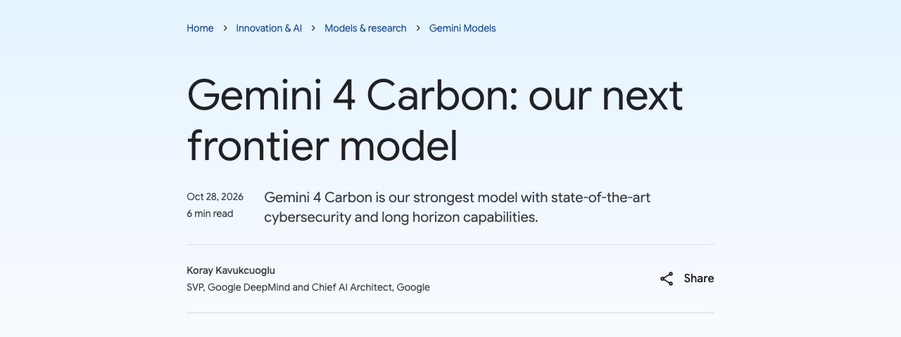{: .shadow }
_Google 블로그 (2026-11-01 캡처)_

Google이 10월 28일(미국) 사이버보안과 긴 작업에 강하다는 Gemini 4 Carbon을 공개했습니다. Artificial Analysis Intelligence Index v5.0에서 59점으로 1위, 취약점 찾기 벤치마크 SEC-bench Pro에서 88.2%라고 밝혔습니다(회사 발표). 지금은 일부 사이버 방어 팀에만 제공하고, 개발자와 일반 사용자에게는 안전장치를 다듬은 뒤 「가능한 한 빨리」 열겠다고 했습니다. 가격은 Argon과 같은 100만 토큰당 입력 $2, 출력 $10으로 예고됐습니다.

### Mistral Large 4 가중치 공개

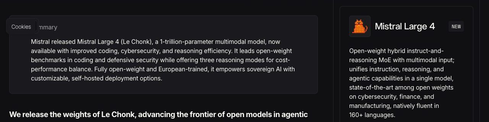{: .shadow }
_Mistral 발표 페이지 (2026-11-01 캡처)_

10월 7일 호에서 「이달 말 가중치 공개」로 소개한 Mistral Large 4의 가중치가 10월 29일 공개됐습니다. Hugging Face에서 받아 vLLM이나 SGLang으로 직접 운영할 수 있습니다. 다만 1조 파라미터 모델이라 집에서 돌릴 크기는 아닙니다.

### LiquidAI LFM3: 휴대폰과 노트북용 2B급 모델 묶음

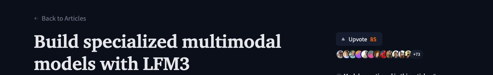{: .shadow }
_Hugging Face 블로그 (2026-11-01 캡처)_

LiquidAI가 10월 28일 LFM3를 공개했습니다. LFM3-1.7B 하나를 바탕으로 텍스트, 비전, 오디오, 옴니 모델을 만들었고, 휴대폰과 Raspberry Pi 5부터 노트북, NPU까지 14가지 기기와 실행 환경에서 빠르게 돌도록 설계했다고 합니다. GGUF(llama.cpp, Ollama, LM Studio)와 Apple Silicon용 MLX 판이 함께 나와 있습니다. 라이선스는 「other」라 쓰기 전에 조건을 확인해야 합니다.

### Altman: 「RAM은 책상보다 데이터센터에 있는 게 낫다」

{: .shadow }
_The Verge 기사 (2026-11-01 캡처)_

OpenAI CEO Sam Altman이 팟캐스트에서, 세계의 한정된 DRAM을 각자 컴퓨터에 두고 잠깐씩만 쓰는 것은 전체 배분 관점에서 좋지 않다며 클라우드에서 최대한 활용하는 편이 낫다고 말했습니다(The Verge, 10월 30일 미국). 로컬 LLM을 돌리려고 메모리 큰 장비를 고민하는 쪽에서는 생각이 다를 만한 이야기입니다.

## 회사와 일자리

### Anthropic 상장 신청: 처음 공개된 실제 숫자

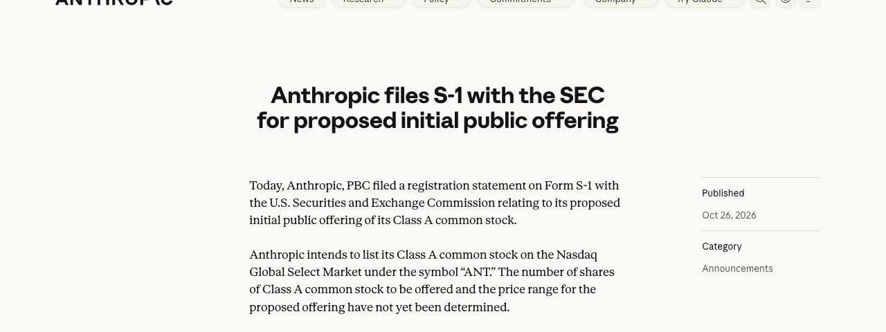{: .shadow }
_Anthropic 발표 페이지 (2026-11-01 캡처)_

Anthropic이 10월 26일 미국 증권거래위원회(SEC)에 상장 신청서(S-1)를 냈습니다. Nasdaq에 「ANT」로 상장할 계획이고, 공모 주식 수와 가격은 아직 정하지 않았습니다. 신청서에 나온 숫자입니다.

| 항목 | 수치 |
|---|---|
| 매출 2025년 | 45억 8,500만 달러 |
| 매출 2025년 상반기 → 2026년 상반기 | 11억 6,300만 달러 → 162억 8,600만 달러 |
| 영업손실 2026년 상반기 | 6억 9,300만 달러 |
| 직원 수 | 약 940명(2024년 말) → 약 5,300명(2026년 9월 말) |

### Microsoft, 직원 약 6만 명에게 자발적 퇴직 제안

Microsoft가 10월 26일(미국) 직원 약 6만 명, 전체의 약 4분의 1에게 자발적 퇴직을 제안했습니다. 12월 초까지 결정하면 됩니다. 회사는 수락률을 3~5%(3,000명 미만)로 예상하며, 해고를 피하면서 인건비를 줄이려는 조치라고 The Seattle Times는 전했습니다.

### 한국은행: 생성형 AI 이후 경력직 선호, 대구 청년고용률 36.9%

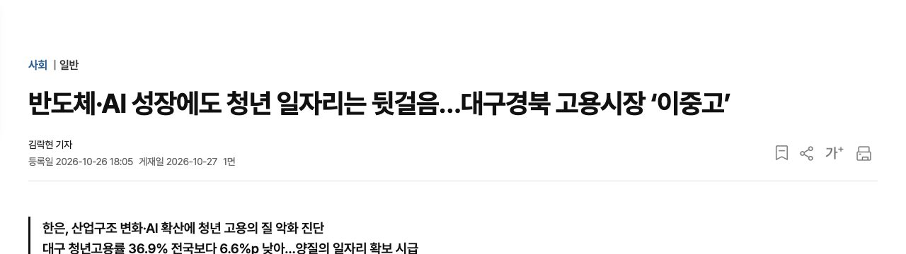{: .shadow }
_경북매일 기사 (2026-11-01 캡처)_

- 한국은행은 생성형 AI 확산과 산업구조 변화로 청년들이 양질의 일자리를 얻기 어려운 환경이 되고 있다고 분석했습니다(경북매일, 10월 26일).
- 9월 고용동향에서 대구 청년고용률은 36.9%로 전국 평균 43.5%보다 6.6%포인트 낮았습니다.
- 동아일보는 「AI 포트폴리오」를 대신 만들어 준다는 업체를 취재했습니다. 한 중개 플랫폼에서 판매 업체가 200여 곳 나왔고, 변호사는 대행 포트폴리오로 지원하면 업무방해죄가 될 수 있다고 했습니다.

### 네이버 D2: 「AI 시대의 개발자를 꿈꾸는 학생 개발자에게」

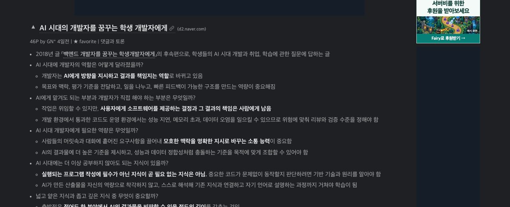{: .shadow }
_긱뉴스 (2026-11-01 캡처)_

네이버 D2에 2018년 글 「백엔드 개발자를 꿈꾸는 학생개발자에게」의 후속편이 올라왔습니다. 학생들이 AI 시대의 개발과 취업, 공부에 대해 물은 것에 답하는 글입니다. 개발자는 AI에게 방향을 지시하고 결과를 책임지는 역할로 바뀌고 있다고 말합니다. 긱뉴스에서 이번 주 가장 많은 추천(46점)을 받았습니다.

## 지금 모집 중 (마감 순서)

{: .shadow }
_중앙일보 기사 (2026-11-01 캡처)_

| 마감 | 모집 | 대상 |
|---|---|---|
| 11/3 | 2026 청도바이브코딩 해커톤(대구한의대 주관). 11/5~6 청도, GitHub Copilot 에이전트와 Azure로 서비스를 만들어 배포, 총상금 500만 원, 참가비 무료, 11/5 08:00 동대구역 셔틀 | IT 개발에 관심 있는 청년, 1~4명 |
| 11/6 | 2026 트릴리온 에이전트 AI 해커톤. 11/19~20 서울 드림플러스 강남, 24시간, 국산 오픈소스 모델 Zoro-1로 에이전트 만들기 등 2개 트랙, 트랙별 우승팀 100만 원과 팀원 인턴십 기회 | 만 18세 이상 누구나 |

일정과 조건은 기사 기준입니다. 지원하기 전에 주최 측 공고를 꼭 확인하세요.

## 볼 때 주의할 점

- 가짜 확장 내려받기 「약 5,000대」는 Wired 보도 수치입니다. Cursor 공지에는 설치 시간대와 점검 방법이 있습니다.
- Claude Code 상태 줄 비용(16.4%)은 한 회사의 자체 측정입니다. 쓰는 방식에 따라 다릅니다.
- Cohere의 Qwen3.8 사례는 경쟁사가 낸 한 건의 보고입니다.
- Gemini 4 Carbon 벤치마크와 LFM3 성능은 회사 발표입니다.
- Anthropic 숫자는 상장 신청서의 회사 공시이고, 상장 절차 중에 바뀔 수 있습니다.
- 국내 AI 해킹 수치는 경찰 발표를 기사로 본 것입니다.

## 출처

- Cursor, [보안 공지 — Cursor VS Code 확장 프로그램 마켓플레이스에서 Anthropic.claude-code 악성 버전 확인](https://cursor.com/blog/claude-code-extension-security-notice)
- Phorion, [Official Claude Code Extension Compromise: Security Advisory](https://phorion.io/blog/offical-claude-code-vsx-compromise/) (2026-10-30)
- WIRED, [A Supply Chain Attack Put Malicious Anthropic Claude Extensions on Thousands of Devices](https://www.wired.com/story/trojan-malware-targets-thousands-of-anthropic-claude-developer-systems/)
- 지디넷코리아, ['모두의 AI 해킹' 시대 왔나…개인정보 820만건 탈취 일당 덜미](https://zdnet.co.kr/view/?no=20261027074733) (2026-10-27)
- 한국경제, [IT비전공자가 AI 해킹…병원·대학도 털렸다](https://www.hankyung.com/article/2026102660191) (2026-10-26)
- KBS, [은행 이어 대학까지…외부 시스템 뚫려 정보 유출](https://news.kbs.co.kr/news/view.do?ncd=8698891) (2026-10-29)
- 연합뉴스, [당국, 금융권에 해킹 보안 개선계획 마련 촉구…내주 점검회의](https://www.yna.co.kr/view/AKR20261031045700002) (2026-11-01)
- 뉴스핌, [금융권 해킹에 멈춘 '망분리 완화' 내달 재개 방침…전면 해제는 신중](https://www.newspim.com/news/view/20261029001188) (2026-10-29)
- Cohere, [Concerning behavior from a popular open-weight AI model](https://cohere.com/blog/concerning-behaviour-popular-open-weight-ai-model) (2026-10-26)
- Claude, [X 글 Max 요금제 이름 변경](https://x.com/claudeai/status/2116220869479428500) (2026-10-31)
- Tibo Sottiaux, X 글 [20일차](https://x.com/thsottiaux/status/2114200152701575656), [21일차](https://x.com/thsottiaux/status/2114588174249071102), [22일차](https://x.com/thsottiaux/status/2114800277677092936), [23일차](https://x.com/thsottiaux/status/2115273064481218829), [24일차](https://x.com/thsottiaux/status/2115622002581188681), [25일차](https://x.com/thsottiaux/status/2115850175868727621), [26일차](https://x.com/thsottiaux/status/2116405414921384099), [적립형 초기화 1/2](https://x.com/thsottiaux/status/2116692529970311254)
- Flamerix AI, [Claude Code burns ~15-20% of your tokens on a 3-word status line](https://gist.github.com/flamerix-ai/c3905705cc4205e5de3011fa2e74efce) (2026-10-27)
- Anthropic, [claude-code CHANGELOG](https://github.com/anthropics/claude-code/blob/main/CHANGELOG.md)
- OpenAI, [X 글 GPT-6.1 Terra](https://x.com/OpenAI/status/2114780711664398349) (2026-10-27)
- Google, [Introducing Gemini 4 Carbon](https://blog.google/innovation-and-ai/models-and-research/gemini-models/introducing-gemini-4-carbon/) (2026-10-28, 미국)
- Mistral, [Mistral Large 4 is now open weight](https://mistral.ai/news/mistral-large-4-oss/)
- Hugging Face, [Build specialized multimodal models with LFM3](https://huggingface.co/blog/LiquidAI/lfm3), [LiquidAI/LFM3-1.7B](https://huggingface.co/LiquidAI/LFM3-1.7B)
- The Verge, [Sam Altman says it’s better for RAM to be in a data center than on your desk](https://www.theverge.com/ai-artificial-intelligence/1023820/sam-altman-ram-shortage-cloud-servers)
- Anthropic, [Anthropic files S-1 with the SEC for proposed initial public offering](https://www.anthropic.com/news/s1-sec) (2026-10-26)
- The Seattle Times, [Microsoft offers buyouts to 60K employees, but expects low uptake](https://www.seattletimes.com/business/microsoft/microsoft-offers-mass-buyouts-for-roughly-a-quarter-of-its-workforce/)
- 경북매일, [반도체·AI 성장에도 청년 일자리는 뒷걸음…대구경북 고용시장 ‘이중고’](https://www.kbmaeil.com/article/20261026500595) (2026-10-26)
- 동아일보, [“AI 포트폴리오, 50만원이면 뚝딱” 취준생 노리는 대행업체](https://www.donga.com/news/Society/article/all/20261030/134936479/2) (2026-10-30)
- 네이버 D2, [AI 시대의 개발자를 꿈꾸는 학생 개발자에게](https://d2.naver.com/helloworld/1975819) (2026-10-27), 긱뉴스 [소개 글](https://news.hada.io/topic?id=36135)
- 중앙일보, [대구한의대, 청도서 ‘AI 에이전트 활용 해커톤’ 연다](https://www.joongang.co.kr/article/25473687) (2026-10-28)
- 플래텀, [국산 오픈소스 AI 모델로 에이전트 만들고 우승하면 인턴십, 트릴리온랩스 해커톤 참가팀 모집](https://platum.kr/archives/297424) (2026-10-30)

공개 자료를 정리한 글입니다. 수치는 각 출처를 인용한 것이며 독립적으로 검증한 결과가 아닙니다. 각 소식 아래 화면은 출처 페이지를 2026-11-01에 캡처한 것이며, 언론 기사는 제목 부분만 실었습니다.
