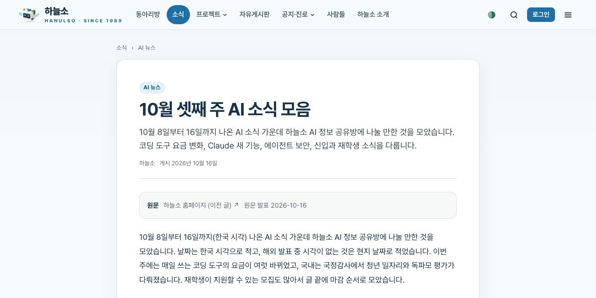

하늘소 동문과 재학생이 함께 쓰는 커뮤니티 사이트 **[hanulso.net](https://hanulso.net)** 이 열렸습니다. 소식을 읽는 것뿐 아니라 직접 글을 쓰고, 만든 것을 소개하고, 동문끼리 안부를 나누는 곳입니다.

{: width="768" }
_hanulso.net_

## 무엇이 있나요

| 메뉴 | 내용 |
|---|---|
| 동아리방 | 3D로 꾸민 동아리방입니다. 동문이 방 안의 자리를 눌러 한마디를 남길 수 있습니다 |
| 소식 | AI 뉴스, IT 뉴스, 최신 논문, AI 활용 정보 |
| 프로젝트 | 함께 만드는 프로젝트, 그리고 AI로 만든 작품을 소개하는 AI 작품 홍보관 |
| 자유게시판 | 자유 이야기, 질문, 스터디 모집 |
| 공지·진로 | 공지사항과 취업, 인턴, 공모전 같은 진로·채용 정보 |
| 사람들 | 회원이 공개하기로 한 소개(명함) |
| 하늘소 소개 | 1989년부터 이어 온 하늘소의 연혁과 작품, 언론에 실린 기록 |

## 가입하면 할 수 있는 것

Google, 카카오, GitHub, 네이버 계정으로 로그인합니다.

- **가입 회원**: 소식, 진로, 자유게시판에 글을 쓰고, AI 작품 홍보관에 작품을 올리고, 댓글을 남길 수 있습니다.
- **동문 확인을 받으면**: 공지와 프로젝트를 올리고, 동문 사진첩과 동아리방 한마디를 쓸 수 있습니다.

## 앞으로 AI 소식은 hanulso.net에 올립니다

이 블로그에 올리던 주간 AI 소식은 앞으로 **[hanulso.net 소식 › AI 뉴스](https://hanulso.net/news)** 에 올립니다. 하늘소 AI 정보 공유방에도 hanulso.net 주소로 공유합니다.

{: .shadow }
_hanulso.net으로 옮긴 「10월 셋째 주 AI 소식 모음」_

이 블로그에 올린 글 12편(AI 소식과 공지)은 hanulso.net으로 모두 옮겨 두었습니다. 옛 글 주소의 앞부분만 바꿔 열어도 옮긴 글로 이동합니다.

- 예: `hanulso.github.io/posts/ai-news-2026-11-01/` → `hanulso.net/posts/ai-news-2026-11-01`

이 블로그(hanulso.github.io)의 글은 지우지 않고 그대로 둡니다.
